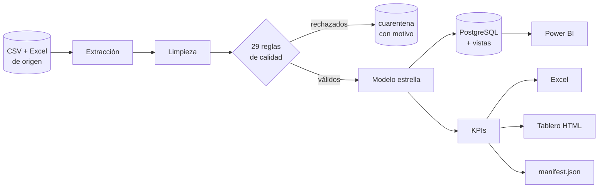
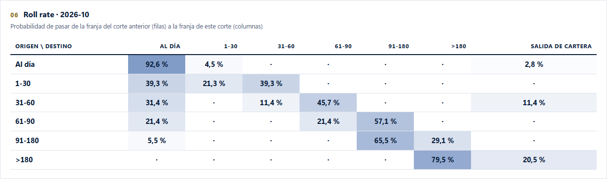

<div align="center">

# Radar de Cartera

**Del exporte sucio al comité de cartera.** Pipeline ETL y analítica de cartera y cobranzas:
toma los exportes en CSV y Excel tal como llegan, los limpia, separa en cuarentena lo que no
sirve, arma un modelo estrella en PostgreSQL y entrega KPIs de riesgo y gestión en Excel, en un
tablero web y en Power BI, con los mismos números en los tres.

[](https://github.com/DarwinMontiel/radar-cartera/actions/workflows/ci.yml)
[](https://darwinmontiel.github.io/radar-cartera/)


[](LICENSE)

[**Ver el tablero en vivo**](https://darwinmontiel.github.io/radar-cartera/) ·
[KPIs](docs/kpis.md) · [Calidad de datos](docs/calidad-de-datos.md) ·
[Arquitectura](docs/arquitectura.md) · [Power BI](powerbi/README.md)

<picture>
  <source media="(prefers-color-scheme: dark)" srcset="docs/imagenes/tablero-dark.png">
  
</picture>

</div>

---

## El problema

Un equipo de cobranzas recibe cada mes exportes de varios sistemas: el corte de cartera del
core, el recaudo en Excel y las gestiones del CRM. Llegan con documentos con puntos, montos
como texto (`$ 1.234.567`), fechas en dos formatos, pagos duplicados por una doble exportación
y gestiones que apuntan a obligaciones que no existen. Con eso hay que responder:

- ¿Cuánto de la cartera está en riesgo (PAR30) y cómo evoluciona?
- ¿Cuánto se recuperó y qué tan efectiva fue la gestión sobre lo vencido?
- ¿Qué tan rápido se deteriora o se cura la cartera (roll rates)?
- ¿Qué gestores convierten sus promesas de pago en recaudo real?

…y que la respuesta sea **la misma** en el Excel, en el tablero y en Power BI.

## Antes y después

Filas reales de la muestra pública [`data/muestra`](data/muestra) (datos sintéticos) antes y
después de la limpieza (`␣` marca un espacio):

| Campo | Exporte original | Después de `transform.py` |
|---|---|---|
| Documento | `9.985.859.791` | `9985859791` |
| Nombre | `␣␣SARA␣␣␣RODRÍGUEZ CÁRDENAS␣` | `Sara Rodríguez Cárdenas` |
| Ciudad | `barranquilla` | `Barranquilla` |
| Valor del pago | `$ 6.204.000` (texto) | `6204000.0` |
| Fecha del pago | `07/06/2026` | `2026-06-07` |
| Resultado de gestión | `␣buzón de voz␣` | `Buzón de voz` |

Y lo que no se puede arreglar no se descarta en silencio: va a `rechazados.csv` con el registro
original y el motivo.

| Conjunto | Registro original | Motivo |
|---|---|---|
| pagos | `PG-0000020` · obligación `OB-9000019` · $ 2.440.900 | `obligacion_inexistente` |
| pagos | `PG-0000058` · obligación `OB-0000046` · valor `-108800` | `valor_invalido` (las reversiones van por otro flujo) |

## La historia de una obligación

Para ver qué hace cada etapa, sigamos la obligación `OB-0000015` de la muestra: una tarjeta de
crédito de una financiera **ficticia**, con gestores también ficticios.

| Corte | Días de mora | Franja |
|---|---|---|
| mayo a julio | 0 | Al día |
| 31-ago | 1 | 1-30 |
| 30-sep | 45 | 31-60 |
| 31-oct | 54 | 31-60 |

1. **13 de septiembre.** Ana Lucía Ríos, del equipo de cobranza temprana, llama al cliente y
   obtiene una promesa de **$ 457.900 para el 20-sep**. La ventana de la promesa va hasta el
   23-sep (3 días de gracia) y no entra ningún pago: **promesa incumplida**.
2. **4 de octubre.** La obligación ya está en 31-60 y pasa al equipo de mora tardía. Karen
   Salazar consigue una nueva promesa de **$ 452.900 para el 11-oct**. Tampoco se cumple.
3. **25 de octubre.** Karen vuelve a llamar y el cliente promete **$ 430.400 para el 27-oct**.
   Ese mismo día entra un pago por PSE de **$ 456.200**, más del 90 % de lo prometido:
   **promesa cumplida**, y ese recaudo suma en el ranking de Karen. Si dos promesas abiertas
   compitieran por el mismo pago, contaría solo para la gestión más reciente
   ([regla de último toque](docs/kpis.md#un-pago-una-sola-promesa-atribución-por-último-toque)).
4. **Corte de octubre.** En la matriz de roll rate, la obligación aparece en la celda
   *31-60 → 31-60*: pagó, pero no lo suficiente para ponerse al día.

Esa misma historia, multiplicada por miles de obligaciones, es lo que el tablero resume en la
*lectura para el comité*: si el PAR30 sube o baja, cuánto de la franja 1-30 se cura y cuántas
promesas se cumplen.

## Qué hace



| | |
|---|---|
| **Limpieza auditable** | Documentos, nombres, ciudades y resultados normalizados (sin importar tildes ni mayúsculas); montos en formato colombiano; fechas ISO, `dd/mm/aaaa` y celdas de Excel en la misma columna. |
| **Calidad de datos** | Motor de reglas declarativo: integridad referencial, dominios, duplicados, fechas futuras, promesas incompletas. Los rechazados quedan en cuarentena con el registro original y el motivo. |
| **Modelo dimensional** | 4 dimensiones y 4 hechos; snapshot mensual de cartera; promesas evaluadas contra pagos reales con ventana de gracia y un pago atribuido a una sola promesa. |
| **Carga segura** | *Full refresh* en una sola transacción: idempotente y atómica (si falla, la base queda como estaba). |
| **Reproceso de meses pasados** | `--as-of 2026-08-31` recalcula agosto con exportes más nuevos: lo posterior queda fuera de alcance, no en cuarentena. |
| **KPIs consistentes** | Una definición por KPI en pandas, SQL y DAX; **las pruebas comparan pandas con SQL** en SQLite y en PostgreSQL. |
| **Entregables para negocio** | Excel con Tablas, gráficos nativos y formato condicional; tablero HTML publicado por CI con lectura para el comité y descarga de rechazados. |
| **Power BI** | Vistas SQL de consumo, medidas DAX (inteligencia de tiempo, `USERELATIONSHIP`, `RANKX`) y consultas Power Query parametrizadas. |

## KPIs

| KPI | Definición |
|---|---|
| PAR30 / PAR90 | Saldo con más de 30 / 90 días de mora ÷ saldo total |
| Tasa de recuperación | Recaudo del mes ÷ saldo vencido del **corte anterior** |
| Contactabilidad | Gestiones con contacto ÷ gestiones |
| Efectividad de promesas | Promesas cumplidas (≥ 90 % pagado hasta 3 días después) ÷ promesas **evaluables** |
| Roll rate | Matriz de transición entre franjas de mora de cortes consecutivos, incluida la salida de cartera |
| Ranking de gestores | `DENSE_RANK` por recaudo de promesas cumplidas |

Fórmulas, casos de borde y su justificación en [docs/kpis.md](docs/kpis.md).



## Inicio rápido

```bash
git clone https://github.com/DarwinMontiel/radar-cartera.git
cd radar-cartera
python -m venv .venv && source .venv/bin/activate     # Windows: .venv\Scripts\activate
pip install -e ".[dev]"

cartera generate --out data/raw                        # exportes sintéticos con anomalías
cartera run --raw data/raw --out reports --db sqlite:///reports/dw.sqlite
```

```text
Ejecución 20261112T222738-da3e57 · corte 2026-10
  Registros rechazados: 104
  Saldo total: $ 15.217.214.500 · PAR30 11,4 %
  Recaudo del mes: $ 66.432.800
  Cargado al DW: 30.951 filas
  Reportes en .../reports
```

Archivos generados:

```text
reports/
├── index.html                    # tablero
├── reporte_cartera_2026-10.xlsx  # reporte gerencial
├── rechazados.csv                # cuarentena: conjunto, motivo, registro original
├── kpi_mensual.csv
└── manifest.json                 # trazabilidad: filas por etapa, tiempos, rechazos, fuera de alcance
```

Para recalcular un mes pasado: `cartera run --raw data/raw --out reports/agosto --as-of 2026-08-31`.
Con PostgreSQL en Docker: `make dw` (levanta la base y ejecuta el pipeline contra ella).
¿Solo quieres ver los datos de entrada? Hay una muestra pequeña en [data/muestra](data/muestra).

## Calidad

- **Prueba de detección exacta:** el generador registra cuántas anomalías inyecta de cada tipo y
  la prueba exige que el pipeline las detecte todas, por motivo y conjunto de datos, sin falsos
  positivos.
- **Prueba de consistencia:** las vistas SQL y los KPIs de pandas se comparan número a número.
- **Escenario calculado a mano:** cada KPI se valida contra valores esperados en un caso pequeño
  documentado (`tests/conftest.py::tiny_data`), incluido el de dos promesas solapadas.
- **CLI probada** con `CliRunner`: formato colombiano en la salida y errores en español sin
  *traceback*.
- `mypy --strict`, Ruff (incluye reglas de pandas y de seguridad) y 99 % de cobertura medida
  localmente, CLI incluida. CI exige un mínimo de 90 %, corre todo contra **PostgreSQL 16** y
  publica el tablero en GitHub Pages.

```bash
make lint test          # local
make integration        # con CARTERA_DATABASE_URL apuntando a PostgreSQL
```

## Estructura

```text
src/radar_cartera/
├── extract.py        # lectura de CSV/Excel sin inferencia de tipos
├── transform.py      # limpieza vectorizada y alcance por fecha de corte
├── quality.py        # motor de reglas y cuarentena
├── model.py          # esquema estrella y evaluación de promesas
├── warehouse.py      # DDL, carga transaccional, vistas
├── sql/views.sql     # vistas de consumo (SQL estándar)
├── kpis.py           # indicadores
├── formato.py        # $ 1.234.567 y 9,3 % sin depender de locale
├── report_excel.py   # reporte Excel (openpyxl)
├── report_html.py    # tablero (Jinja2 + Chart.js)
├── synthetic.py      # generador de datos sintéticos
├── pipeline.py       # orquestación y manifiesto
└── cli.py            # cartera generate | run | ddl
powerbi/              # medidas DAX, Power Query y guía del modelo
sql/                  # consultas analíticas de ejemplo (probadas en CI)
docs/                 # arquitectura, KPIs, calidad de datos, ADR
```

## Decisiones de diseño

| ADR | Decisión |
|---|---|
| [0001](docs/adr/0001-esquema-estrella.md) | Esquema estrella con snapshot mensual |
| [0002](docs/adr/0002-carga-full-refresh-transaccional.md) | Carga *full refresh* transaccional e idempotente (y cuándo migrar a incremental) |
| [0003](docs/adr/0003-una-definicion-por-kpi.md) | Una definición por KPI, verificada en pandas y SQL |
| [0004](docs/adr/0004-datos-sinteticos-con-anomalias.md) | Datos sintéticos con anomalías registradas y documentos en un rango ficticio |

## Qué demuestra y su relación con mi experiencia

| En este repositorio | De dónde viene |
|---|---|
| Limpieza de exportes de cobranza con formatos colombianos, duplicados y referencias huérfanas | Scripts de Python y pandas para procesar y analizar datos, y reportes de KPIs en una línea de cobranzas |
| KPIs de cartera (PAR, roll rate, efectividad de promesas) con una sola definición en SQL, pandas y DAX | Tableros de Power BI y consultas SQL para el seguimiento de indicadores de cobranza |
| Cuarentena auditable, carga idempotente y manifiesto por ejecución | Bots RPA en producción para una fintech de gestión de cartera, donde cada ejecución debe poder repetirse y auditarse |
| Reglas de negocio explícitas y probadas (promesas, gracia, último toque) | Experiencia en una línea de cobranzas y en una fintech de cartera: el dato tiene que cuadrar con lo que el gestor registró en la llamada |

### Otros proyectos del portafolio

- [colmena-rpa](https://github.com/DarwinMontiel/colmena-rpa): plataforma de bots RPA con colas
  RabbitMQ, reintentos, DLQ e idempotencia.
- [torre-de-control](https://github.com/DarwinMontiel/torre-de-control): monitoreo en tiempo real
  de las colas de colmena-rpa (TypeScript, Fastify, Redis, WebSocket).
- [faro-cobranza](https://github.com/DarwinMontiel/faro-cobranza): CRM de cobranza con acuerdos
  de pago y API REST para bots.
- [vigia-ocr](https://github.com/DarwinMontiel/vigia-ocr): bot con Selenium, OCR y SQL Server.
- [puente-llm](https://github.com/DarwinMontiel/puente-llm) ·
  [robot-pedidos-robocorp](https://github.com/DarwinMontiel/robot-pedidos-robocorp) ·
  [tu-amigo-viajero](https://github.com/DarwinMontiel/tu-amigo-viajero)

## Hoja de ruta

- [ ] Carga incremental por corte con `COPY` para volúmenes de millones de filas.
- [ ] Dimensión cliente SCD tipo 2 (historia de segmento y ciudad).
- [ ] Orquestación programada (cron / Airflow) y alertas cuando una regla supere un umbral.
- [ ] Modelo de propensión de pago para priorizar la gestión.

## Autor

**Darwin Montiel Mora**: desarrollador RPA y backend. Bogotá, Colombia.
[LinkedIn](https://www.linkedin.com/in/darwin-montiel-mora-925216206) · [GitHub](https://github.com/DarwinMontiel)

Todos los datos del repositorio son sintéticos: personas, documentos, gestores y entidades son
ficticios. Licencia [MIT](LICENSE).
