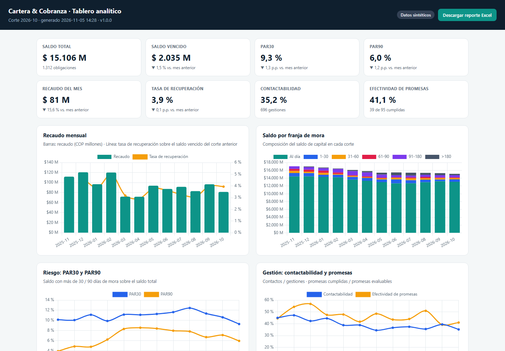
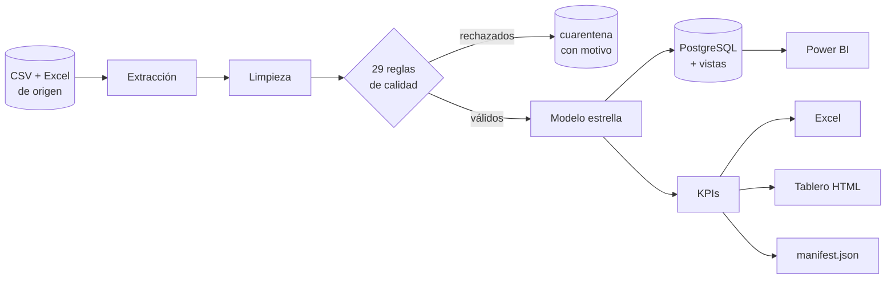

<div align="center">

# Cartera Analytics

**Pipeline ETL y analítica de cartera y cobranzas: de exportes "sucios" en CSV y Excel a un
modelo estrella en PostgreSQL, KPIs de riesgo y gestión, Power BI y reportes listos para negocio.**

[](https://github.com/DarwinMontiel/radar-cartera/actions/workflows/ci.yml)
[](https://darwinmontiel.github.io/radar-cartera/)


[](LICENSE)

[**Ver tablero en vivo**](https://darwinmontiel.github.io/radar-cartera/) ·
[KPIs](docs/kpis.md) · [Calidad de datos](docs/calidad-de-datos.md) ·
[Arquitectura](docs/arquitectura.md) · [Power BI](powerbi/README.md)



</div>

> **English summary** — End-to-end analytics pipeline for a loan-collections portfolio. It
> ingests messy CSV/Excel exports, standardizes them with vectorized pandas, enforces 29
> declarative data-quality rules with quarantine and audit trail, builds a Kimball star schema
> (monthly portfolio snapshot + payments, collection calls and payment promises), loads it into
> PostgreSQL transactionally, and computes risk and collections KPIs (PAR30/90, recovery rate,
> roll rates, promise-keeping, agent ranking). The same KPI definitions live in pandas, SQL views
> and DAX measures, and the test suite proves pandas and SQL return identical numbers. Outputs:
> a formatted Excel workbook with native charts, an HTML dashboard published to GitHub Pages by
> CI, and Power BI-ready views.

---

## El problema

Un equipo de cobranzas recibe cada mes exportes de varios sistemas: el corte de cartera del
core, el recaudo en Excel, las gestiones del CRM. Llegan con documentos con puntos, montos como
texto (`$ 1.234.567`), fechas en dos formatos, pagos duplicados por una doble exportación y
gestiones que apuntan a obligaciones que no existen. Con eso hay que responder:

- ¿Cuánto de la cartera está en riesgo (PAR30) y cómo evoluciona?
- ¿Cuánto se recuperó y qué tan efectiva fue la gestión sobre lo vencido?
- ¿Qué tan rápido se deteriora o se cura la cartera (roll rates)?
- ¿Qué gestores convierten sus promesas de pago en recaudo real?

…y que la respuesta sea **la misma** en el Excel, en el tablero y en Power BI.

## Qué hace



| | |
|---|---|
| **Limpieza auditable** | Documentos, nombres, ciudades y resultados normalizados (insensible a tildes y mayúsculas); montos en formato colombiano; fechas ISO, `dd/mm/aaaa` y celdas de Excel en la misma columna. |
| **Calidad de datos** | Motor de reglas declarativo: integridad referencial, dominios, duplicados, fechas futuras, promesas incompletas. Los rechazados quedan en cuarentena con el registro original y el motivo. |
| **Modelo dimensional** | 4 dimensiones y 4 hechos; snapshot mensual de cartera; promesas evaluadas contra pagos reales con ventana de gracia. |
| **Carga segura** | *Full refresh* en una sola transacción: idempotente y atómica (si falla, la base queda como estaba). |
| **KPIs consistentes** | Una definición por KPI en pandas, SQL y DAX; **las pruebas comparan pandas vs. SQL** en SQLite y en PostgreSQL. |
| **Entregables para negocio** | Excel con Tablas, gráficos nativos, formato condicional (escala de color, barras de datos), hoja de calidad y de rechazados. Tablero HTML publicado por CI. |
| **Power BI** | Vistas SQL de consumo, medidas DAX (inteligencia de tiempo, `USERELATIONSHIP`, `RANKX`) y consultas Power Query parametrizadas. |

## KPIs

| KPI | Definición |
|---|---|
| PAR30 / PAR90 | Saldo con más de 30 / 90 días de mora ÷ saldo total |
| Tasa de recuperación | Recaudo del mes ÷ saldo vencido del **corte anterior** |
| Contactabilidad | Gestiones con contacto ÷ gestiones |
| Efectividad de promesas | Promesas cumplidas (≥ 90 % pagado hasta 3 días después) ÷ promesas **evaluables** |
| Roll rate | Matriz de transición entre franjas de mora de cortes consecutivos, incluida la salida de cartera |
| Ranking de gestores | `DENSE_RANK` por recaudo de promesas cumplidas |

Fórmulas, reglas de borde y su justificación en [docs/kpis.md](docs/kpis.md).


## Inicio rápido

```bash
git clone https://github.com/DarwinMontiel/radar-cartera.git
cd radar-cartera
python -m venv .venv && source .venv/bin/activate     # Windows: .venv\Scripts\activate
pip install -e ".[dev]"

cartera generate --out data/raw                        # exportes sintéticos con anomalías
cartera run --raw data/raw --out reports --db sqlite:///reports/dw.sqlite
```

Salida:

```
reports/
├── index.html                    # tablero
├── reporte_cartera_2026-10.xlsx  # reporte gerencial
├── rechazados.csv                # cuarentena: dataset, motivo, registro original
├── kpi_mensual.csv
└── manifest.json                 # trazabilidad: filas por etapa, tiempos, rechazos
```

Con PostgreSQL en Docker: `make dw` (levanta la base y ejecuta el pipeline contra ella).
¿Solo quieres ver los datos de entrada? Hay una muestra pequeña en [data/muestra](data/muestra).

## Calidad

- **Prueba de detección exacta:** el generador registra cuántas anomalías inyecta de cada tipo y
  la prueba exige que el pipeline las detecte todas, por motivo y dataset, sin falsos positivos.
- **Prueba de consistencia:** las vistas SQL y los KPIs de pandas se comparan número a número.
- **Escenario calculado a mano:** cada KPI se valida contra valores esperados en un caso pequeño
  documentado (`tests/conftest.py::tiny_data`).
- `mypy --strict`, Ruff (incluye reglas de pandas y de seguridad) y 99 % de cobertura; en CI
  además se corre todo contra **PostgreSQL 16** y se publica el tablero en GitHub Pages.

```bash
make lint test          # local
make integration        # con CARTERA_DATABASE_URL apuntando a PostgreSQL
```

## Estructura

```
src/radar_cartera/
├── extract.py        # lectura de CSV/Excel sin inferencia de tipos
├── transform.py      # limpieza vectorizada
├── quality.py        # motor de reglas y cuarentena
├── model.py          # esquema estrella y evaluación de promesas
├── warehouse.py      # DDL, carga transaccional, vistas
├── sql/views.sql     # vistas de consumo (SQL estándar)
├── kpis.py           # indicadores
├── report_excel.py   # reporte Excel (openpyxl)
├── report_html.py    # tablero (Jinja2 + Chart.js)
├── synthetic.py      # generador de datos sintéticos
├── pipeline.py       # orquestación y manifiesto
└── cli.py            # cartera generate | run | ddl
powerbi/              # medidas DAX, Power Query y guía del modelo
sql/                  # consultas analíticas de ejemplo (probadas en CI)
docs/                 # arquitectura, KPIs, calidad de datos, ADRs
```

## Decisiones de diseño

| ADR | Decisión |
|---|---|
| [0001](docs/adr/0001-esquema-estrella.md) | Esquema estrella con snapshot mensual |
| [0002](docs/adr/0002-carga-full-refresh-transaccional.md) | Carga *full refresh* transaccional e idempotente (y cuándo migrar a incremental) |
| [0003](docs/adr/0003-una-definicion-por-kpi.md) | Una definición por KPI, verificada en pandas y SQL |
| [0004](docs/adr/0004-datos-sinteticos-con-anomalias.md) | Datos sintéticos con anomalías registradas |

## Hoja de ruta

- [ ] Carga incremental por corte con `COPY` para volúmenes de millones de filas.
- [ ] Dimensión cliente SCD tipo 2 (historia de segmento y ciudad).
- [ ] Orquestación programada (cron / Airflow) y alertas cuando una regla supere un umbral.
- [ ] Modelo de propensión de pago para priorizar la gestión.

## Autor

**Darwin Montiel Mora** — Desarrollador RPA & Backend · Ingeniero de Sistemas
[LinkedIn](https://www.linkedin.com/in/darwin-montiel-mora-925216206) · [GitHub](https://github.com/DarwinMontiel)

Todos los datos del repositorio son sintéticos. Licencia [MIT](LICENSE).
