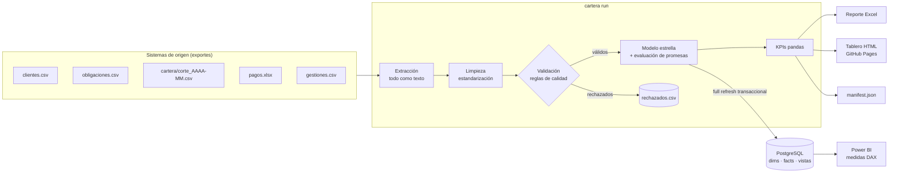
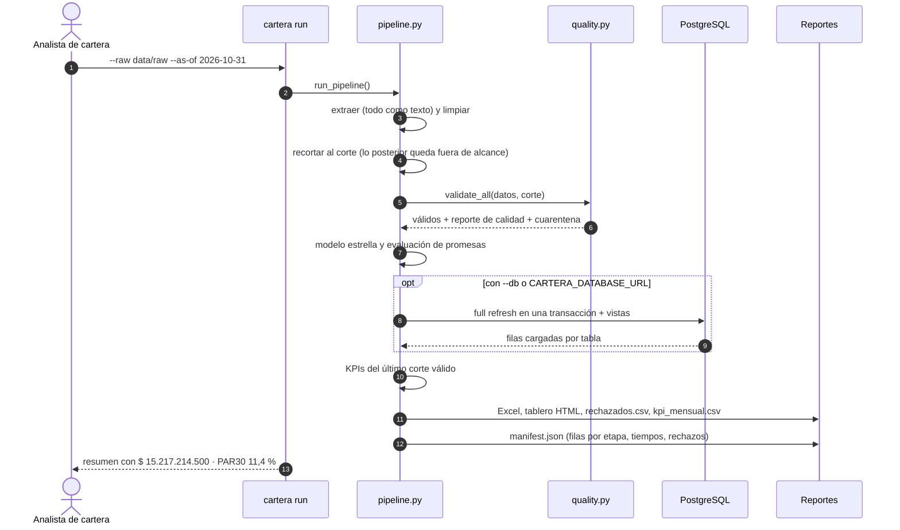
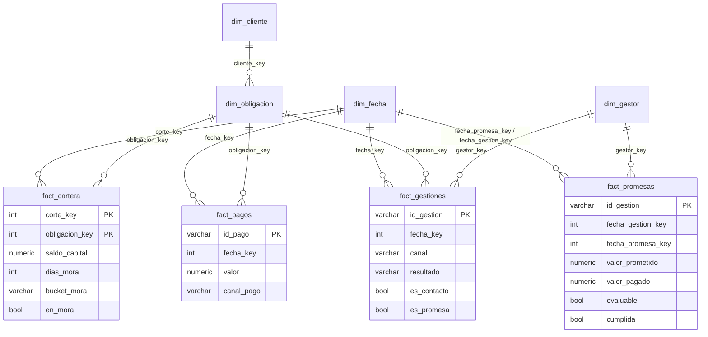

# Arquitectura

## Flujo de datos

| Etapa | Módulo | Responsabilidad |
|---|---|---|
| Extracción | `extract.py` | Lee CSV y Excel sin inferir tipos (un documento `0012345` no se convierte en número). |
| Limpieza | `transform.py` | Funciones puras y vectorizadas de estandarización. |
| Validación | `quality.py` | Motor de reglas declarativo con cuarentena y reporte auditable. |
| Modelado | `model.py` | Llaves sustitutas, dimensión fecha, hechos y evaluación de promesas. |
| Carga | `warehouse.py` | DDL con SQLAlchemy, carga transaccional idempotente y vistas SQL. |
| KPIs | `kpis.py` | Indicadores mensuales, franjas, roll rates, ranking, producto, canal. |
| Reportes | `report_excel.py`, `report_html.py` | Excel con tablas, gráficos y formato condicional; tablero HTML. |
| Orquestación | `pipeline.py`, `cli.py` | Alcance por fecha de corte, pasos cronometrados, manifiesto de ejecución, CLI. |
| Formato | `formato.py` | Montos y porcentajes en formato colombiano (`$ 1.234.567`, `9,3 %`) sin depender de `locale`. |

## Una ejecución, paso a paso

## Modelo dimensional

- `fact_cartera` es un **snapshot periódico** (una fila por obligación y corte): permite
  comparar cortes y calcular roll rates.
- `fact_pagos` y `fact_gestiones` son hechos **transaccionales**.
- `fact_promesas` es un hecho **derivado**: el pipeline cruza cada promesa con los pagos de su
  ventana (cada pago se atribuye a una sola promesa, por *último toque*; ver
  [kpis.md](kpis.md#un-pago-una-sola-promesa-atribución-por-último-toque)) y precalcula
  `valor_pagado`, `evaluable` y `cumplida`, para que Power BI no tenga que hacer ese cruce
  costoso en DAX.
- El DDL completo para PostgreSQL se obtiene con `cartera ddl --dialect postgresql`.

## Decisiones

| ADR | Decisión |
|---|---|
| [0001](adr/0001-esquema-estrella.md) | Esquema estrella con snapshot mensual en lugar de tablas planas |
| [0002](adr/0002-carga-full-refresh-transaccional.md) | Carga *full refresh* transaccional e idempotente |
| [0003](adr/0003-una-definicion-por-kpi.md) | Una sola definición por KPI, verificada en pandas y SQL |
| [0004](adr/0004-datos-sinteticos-con-anomalias.md) | Datos sintéticos con anomalías registradas para probar la calidad |

## Rendimiento

Con la configuración por defecto (1.500 clientes, 12 cortes, ~30 mil filas en el DW) el pipeline
completo corre en ~3 s, de los cuales ~1,5 s son la carga a la base. Para volúmenes de millones
de filas el siguiente paso es reemplazar `DataFrame.to_sql` por `COPY` de PostgreSQL y hacer la
carga incremental por corte (ver ADR-0002).
