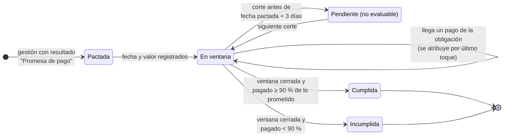

# Diccionario de KPIs

Cada indicador tiene **una sola definición** implementada tres veces: en pandas
(`src/radar_cartera/kpis.py`), en SQL (`src/radar_cartera/sql/views.sql`) y en DAX
(`powerbi/medidas.dax`). Las pruebas verifican que pandas y SQL dan el mismo resultado sobre los
mismos datos, en SQLite (unitarias) y en PostgreSQL (integración).

| KPI | Fórmula | Granularidad | Lectura |
|---|---|---|---|
| **Saldo total** | Σ `saldo_capital` del corte | Corte mensual | Tamaño de la cartera administrada |
| **Saldo vencido** | Σ `saldo_capital` con `dias_mora > 0` | Corte mensual | Cartera que requiere gestión de cobro |
| **PAR30** | Σ saldo con mora > 30 días ÷ saldo total | Corte mensual | *Portfolio at Risk*: principal indicador de riesgo |
| **PAR90** | Σ saldo con mora > 90 días ÷ saldo total | Corte mensual | Riesgo de deterioro / castigo |
| **Recaudo** | Σ `valor` de pagos válidos del mes calendario | Mes de `fecha_pago` | Dinero recuperado por cobranza |
| **Tasa de recuperación** | Recaudo del mes ÷ saldo vencido del **corte anterior** | Mes | Qué porción de lo vencido se logró recuperar |
| **Contactabilidad** | Gestiones con contacto ÷ gestiones | Mes de `fecha_gestion` | Calidad de datos de contacto y estrategia de canal |
| **Efectividad de promesas** | Promesas cumplidas ÷ promesas **evaluables** | Mes de `fecha_promesa` | Calidad de la negociación |
| **Roll rate** | % de obligaciones que pasan de la franja *i* (corte anterior) a la *j* (corte actual) | Par de cortes | Velocidad de deterioro o cura de la cartera |
| **Ranking de gestores** | `DENSE_RANK` por recaudo de promesas cumplidas | Mes de `fecha_gestion` | Productividad del equipo |

## Reglas de negocio

### Franjas de mora (aging)

| Franja | Días de mora |
|---|---|
| Al día | 0 |
| 1-30 | 1 a 30 |
| 31-60 | 31 a 60 |
| 61-90 | 61 a 90 |
| 91-180 | 91 a 180 |
| >180 | más de 180 |

Una obligación que está en un corte y no aparece en el siguiente se clasifica como
**Salida de cartera** (cancelada o castigada) en la matriz de roll rate.

### Promesa de pago cumplida

Una promesa se considera **cumplida** si la suma de los pagos de la misma obligación, desde el
día de la gestión hasta `fecha_promesa + 3 días de gracia`, es **≥ 90 %** del valor prometido.

Solo es **evaluable** si su ventana ya cerró en la fecha de corte; las promesas con ventana
abierta no entran en el denominador (contarlas como incumplidas castigaría injustamente a los
gestores al final de cada mes).

#### Un pago, una sola promesa (atribución por último toque)

Es común que una obligación reciba dos promesas con ventanas solapadas: la gestora de temprana
consigue un compromiso el lunes y el miércoles otro gestor vuelve a llamar y obtiene uno nuevo.
Si el cliente paga el jueves, ese pago **no puede contar dos veces**: inflaría la efectividad
y el recaudo de promesas del ranking.

Regla: cada pago se atribuye a **una sola** promesa, la de la **gestión más reciente** anterior
al pago cuya ventana lo contiene (empate: el `id_gestion` mayor). La promesa anterior queda sin
ese pago y, si no tiene otros, se evalúa como incumplida. Es la convención de *último toque*
habitual en cobranza: el crédito es de quien cerró el compromiso vigente cuando el cliente pagó.
La garantizan dos pruebas: un caso calculado a mano
(`test_overlapping_promises_share_one_payment_by_last_touch`) y una propiedad sobre los datos
sintéticos (lo atribuido a promesas nunca supera lo pagado por obligación).

#### Vida de una promesa de pago

Las *pendientes* no entran al denominador de la efectividad; las *cumplidas* suman su
`valor_pagado` al recaudo de promesas del gestor que hizo la gestión.

### Contacto

Son contacto: *Contacto titular*, *Contacto tercero*, *Promesa de pago* y *Rehúsa pago*.
No son contacto: *No contesta*, *Buzón de voz* y *Número errado*.

## Por qué la tasa de recuperación usa el corte anterior

El recaudo de octubre se obtiene gestionando la cartera que estaba vencida **al cierre de
septiembre**. Dividir por el saldo vencido de octubre mezclaría causa y efecto: las obligaciones
que se normalizaron gracias al pago ya no estarían en el denominador.
