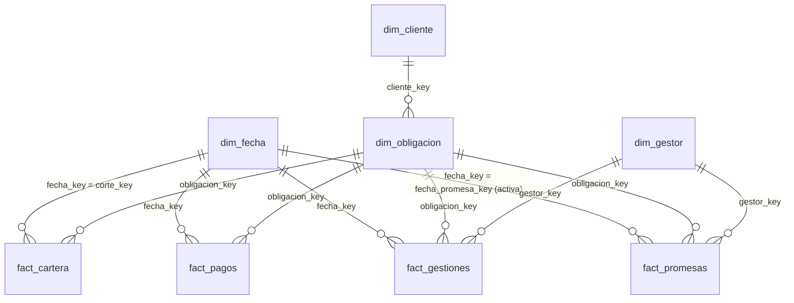

# Modelo de Power BI

Guía para construir el reporte de Power BI sobre el data warehouse que carga el pipeline. El
archivo `.pbix` no se versiona (binario); en su lugar se versionan **las medidas DAX**
([medidas.dax](medidas.dax)) y **las consultas de Power Query** ([conexion_postgres.pq](conexion_postgres.pq)),
que es lo que realmente se revisa en un *code review*.

## 1. Conexión

1. *Obtener datos → PostgreSQL*. Crear los parámetros `ServidorDW` y `BaseDW`.
2. Importar `dim_fecha`, `dim_cliente`, `dim_obligacion`, `dim_gestor`, `fact_cartera`,
   `fact_pagos`, `fact_gestiones`, `fact_promesas` con los tipos de [conexion_postgres.pq](conexion_postgres.pq).
3. Modo **Importación** con actualización programada después de la ejecución diaria del pipeline.

## 2. Relaciones (esquema estrella)

| Relación | Cardinalidad | Filtro | Nota |
|---|---|---|---|
| `dim_fecha[fecha_key]` → hechos | 1:* | Único | Marcar `dim_fecha` como **tabla de fechas** (columna `fecha`) |
| `dim_fecha[fecha_key]` → `fact_promesas[fecha_gestion_key]` | 1:* | Único | **Inactiva**: se activa con `USERELATIONSHIP` |
| `dim_cliente` → `dim_obligacion` | 1:* | Único | Copo de nieve mínimo: segmento y ciudad del cliente |

Buenas prácticas aplicadas: ocultar las columnas `*_key`, ordenar `anio_mes` por `orden_mes`
y `bucket_mora` por `orden_franja`, y formatear `saldo_capital`/`valor` como moneda COP.

## 3. Páginas sugeridas

| Página | Visuales | Medidas |
|---|---|---|
| **Resumen ejecutivo** | Tarjetas, línea de recaudo, barras apiladas por franja | `Saldo Último Corte`, `PAR30`, `Recaudo`, `Recaudo Var %`, `Tasa de Recuperación` |
| **Riesgo** | Matriz de roll rate (desde `vw_roll_rate`), PAR por producto y ciudad | `PAR30`, `PAR90`, `Color PAR30` |
| **Gestión** | Embudo gestiones → contactos → promesas → cumplidas, ranking de gestores | `Contactabilidad`, `Efectividad de Promesas`, `Ranking Gestor` |
| **Calidad de datos** | Tabla desde `reports/manifest.json` / `rechazados.csv` | — |

## 4. Validación

Los totales de Power BI deben coincidir con la vista `vw_kpi_mensual` y con la hoja *Resumen*
del Excel generado. El pipeline ya verifica automáticamente que SQL y pandas producen los
mismos valores (`tests/test_pipeline.py::test_sql_views_match_pandas_kpis`).
